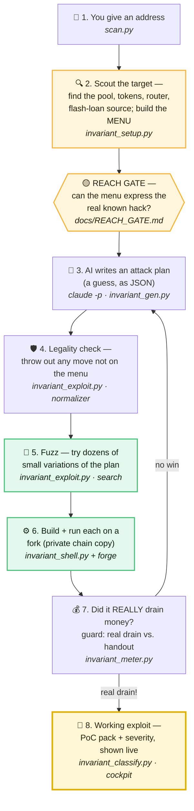

# 🔎 The Invariant Scanner — How It Works

> **In one sentence:** you hand it a single contract address, and it keeps *inventing* attacks and *running each one on a private copy of the blockchain* until one really drains money — then it writes up the proof. It **never touches the real chain** and **never sends a real transaction.**

Think of a locksmith who wants to prove your lock is pickable. Instead of risking your real door, they make a **perfect copy of the lock**, then try key after key on the copy. When a key turns, they hand you that exact key and a video of it working. This scanner does that for smart contracts — and an AI invents the "keys."

---

## 🗺️ The whole flow at a glance

🟡 = where **reach** is decided &nbsp;·&nbsp; 🟢 = **fuzzing + real execution** &nbsp;·&nbsp; 🟡 gold = the **working exploit**

---

## 📚 The 8 stages, explained like you're new to this

Each stage says **what** it does, **when** it runs, **why** it matters, and **which tool** does it.

### 📍 1 — You give it an address
- **What:** You provide one thing: a contract address (and a point in time — a block number).
- **When:** The very start. You run `python ai_search/scan.py --address 0x… --block N`.
- **Why:** That's the whole input. Everything else — the code, the market, the attack — the scanner figures out itself.
- **Tool:** **`ai_search/scan.py`** — the *conductor*. It calls every other tool in order and manages the retry loop.

### 🔍 2 — Scout the target (and build the MENU)
- **What:** Downloads the contract's verified source code, then looks up its **market**: which trading pool it lives in, which two tokens that pool holds (one is the *quote* — the money we measure, e.g. USDT), the router, and an external pool we can borrow a flash-loan from. From all this it builds **the MENU** — the exact list of moves the attacker is allowed to try (buy, sell, transfer, flash-borrow, raw-swap, add/remove liquidity, the contract's own functions…).
- **When:** Once, right after you hit go.
- **Why:** You can't attack what you can't see. And crucially — **the menu is the boundary of what's possible.** The AI in the next stage can *only* pick moves from this menu. If a move isn't on the menu, it can never be tried.
- **Tool:** **`invariant_setup.py`** (market discovery) + **`invariant_exploit.py`** (builds the menu, the allowed amounts, and the written prompt the AI reads). All read-only — it just *reads* the chain, never writes.

### 🟡 2.5 — The REACH GATE (the most important check)
- **What:** Before spending a scan, a human-or-agent reads the **real, proven past hack** of this contract (the actual post-mortem / proof-of-concept) and maps **every step of it onto a menu move**. Verdict: `REACHABLE`, `NEEDS <a new move>`, or `OUT OF SCOPE`.
- **When:** Before the scan runs (recorded in `docs/REACH_GATE.md`).
- **Why:** **The scanner can only ever find what its menu can express.** If the real exploit needs a move the menu doesn't have, the scan is doomed before it starts — so we *add that move to the menu first* (as a general capability, never the specific answer). This is the single rule that separates "a real shot" from "wasting a scan."
- **Tool:** **`docs/REACH_GATE.md`** + the project rule "verify reach before every scan."

> **This is where "reach" is tested.** Reach = *can the menu represent the exploit at all?* It's decided by what Stage 2 puts on the menu and confirmed by the Reach Gate. (The legality check in Stage 4 then *enforces* that boundary on every AI guess.)

### 🧠 3 — The AI writes an attack plan
- **What:** A fresh AI is handed the contract's source code + the menu and asked: *write a sequence of moves that ends with you holding more money than you started.* It replies with a plain **JSON list** of moves. It's an educated **guess** — nothing it says is trusted.
- **When:** At the start of every attempt (up to 4 attempts).
- **Why:** This is the **creative** part. Finding an exploit is like solving a puzzle; the AI is the puzzle-solver that proposes *what to try*. (The tools around it make sure a bad guess is harmless and a good guess is proven.)
- **Tool:** **`claude -p`**, invoked by **`invariant_gen.py`**.

### 🛡️ 4 — Legality check (the fence)
- **What:** Every move in the AI's JSON is checked against the menu and the allowed values. Anything invented — a made-up amount, an off-menu function, a raw address — gets the **entire plan thrown out**.
- **When:** Immediately after the AI replies, before anything runs.
- **Why:** The AI's output is **untrusted**. This fence guarantees it can only ever assemble *real, allowed* moves — it can't smuggle in a new power or arbitrary code. Safety + honesty.
- **Tool:** **`invariant_exploit.py`** (the *normalizer*).

### 🎲 5 — Fuzz it
- **What:** Takes the AI's (now-legal) plan and automatically generates **dozens of small variations** — swap an amount, insert a step, reorder — so a plan that's *almost* right can still land.
- **When:** Right after the plan passes the legality check.
- **Why:** Exploits are fiddly; the exact amount or an extra step often decides success. Fuzzing turns one good idea into many nearby tries, cheaply.
- **Tool:** **`invariant_exploit.py`** (the *search* loop).

### ⚙️ 6 — Build it and run it for real (on a copy)
- **What:** Each candidate is turned into **actual Solidity** — an attacker contract plus the exact moves — and then **run on a fork**: a private, throwaway copy of the blockchain frozen at that block. The money really moves… inside the copy.
- **When:** For every fuzzed candidate.
- **Why:** The only honest way to know if an attack works is to **execute it**. The fork makes that safe: real execution, **zero real transactions, zero risk.** And the Solidity is *templated* — no AI text ever becomes code.
- **Tool:** **`invariant_shell.py`** (writes the Solidity harness) + **`invariant_run.py`** (runs it with `forge` against the fork).

### 💰 7 — Did it *really* drain money? (the honest judge)
- **What:** Measures the attacker's quote balance (e.g. USDT) **before vs. after**. Then a **provenance guard** asks the hard question: did the profit come from a **real drain** (tokens the attacker *bought* or the contract *minted*) — or just from **selling tokens we handed it to start**? A real drain = **SURPLUS**. A handout sale = **clean miss** (not a win).
- **When:** After each run.
- **Why:** This is what makes the scanner **trustworthy** — it will not cry "exploit!" over a fake gain. A bounty is only worth submitting if the drain is real, and this is the gate that proves it.
- **Tool:** **`invariant_meter.py`** (the meter + the provenance guard).

### 🔁 … no win? Steer and retry (×4)
- **What:** If no candidate drained money, the scanner tells the AI *what it already tried and why it failed*, and asks for a fresh plan — looping back to Stage 3.
- **When:** After a losing attempt, up to 4 times total.
- **Why:** The first guess rarely nails a hard exploit. A steered retry is how the scanner *learns across attempts* instead of repeating itself.
- **Tool:** **`invariant_exploit.py`** (the *revision* steer) driven by **`scan.py`**.

### 🏁 8 — A working exploit
- **What:** The winning sequence + the measured profit, written up as a runnable **PoC pack**, labeled by **bug type and severity**, and shown **live** as it happens.
- **When:** The moment a SURPLUS is proven.
- **Why:** The end goal — a concrete, reproducible, measured exploit you can act on (e.g. a bug-bounty submission).
- **Tool:** **`invariant_classify.py`** (type + severity) → `poc_pack.md` → **`cockpit/server.py`** (the live dashboard in your browser).

---

## 🛠️ Tool reference (what / when / why)

| Tool | What it is | When it's called | Why it exists |
|---|---|---|---|
| **`ai_search/scan.py`** | The conductor / entry point | First, and it drives the whole loop | Runs every other tool in the right order and manages the 4-attempt retry |
| **`invariant_setup.py`** | Market discovery (read-only) | Once, at the start | Finds the pool, tokens, router & flash source so the scanner knows *what* it's attacking |
| **`invariant_exploit.py`** | The attack vocabulary + fuzzer | Builds the menu & prompt → validates each guess → fuzzes it | Defines the *reachable* moves, keeps the AI honest (normalizer), and explores around its idea (search) |
| **`invariant_gen.py`** (`claude -p`) | The AI model call | Each attempt, at propose time | The creative part — it *discovers* candidate exploit sequences |
| **`invariant_shell.py`** | The Solidity renderer | Per candidate, before running | Turns a validated sequence into a real, templated attacker contract (no AI text becomes code) |
| **`invariant_run.py`** | The fork driver / scorer | Per candidate | Actually *executes* the attack on a chain copy and captures the result |
| **`invariant_meter.py`** | The meter + provenance guard | After each run | The honest judge — proves a drain is *real*, not a handout; this is what kills false positives |
| **`invariant_classify.py`** | The bug classifier | On a win | Labels the finding by type & severity for reporting |
| **`cockpit/server.py`** | The live dashboard | Throughout | Lets you watch each stage and attempt in real time in a browser |
| **`docs/REACH_GATE.md`** | The reach ledger (process) | Before every scan | Confirms the menu *can* express the known exploit before a scan is spent |

---

## 🔒 Why you can trust it

- **Read-only on the real chain.** Discovery only *reads*; the attack only ever runs on a **private fork**. No real transactions, ever.
- **The AI can't invent powers.** Every move is validated against a fixed menu; made-up moves are discarded.
- **No fake wins.** The provenance guard refuses to count a profit unless it's a *real* drain of the pool — selling tokens the attacker was handed is a clean miss, not a find.
- **The AI still has to be smart.** The menu makes an exploit *possible to express*; **discovering the right sequence is still the AI's job.** A win means the AI genuinely found it.

---

*An educational overview of an autonomous smart-contract exploit-research pipeline (defensive security / bug-bounty research).*
